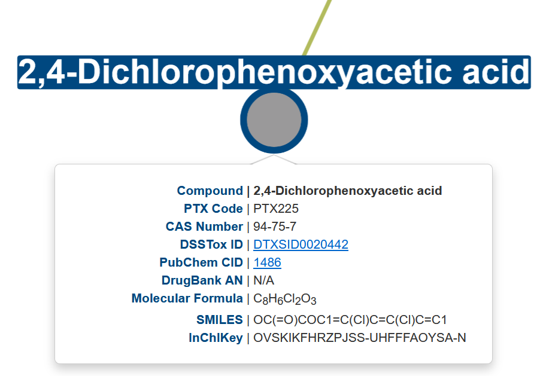
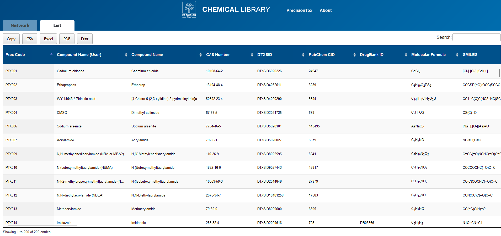

# PrecisionTox Chemical Visualization Tool

[](https://www.gnu.org/licenses/gpl-3.0.html)

The PrecisionTox Chemical Visualization Tool is a web-based application developed
to facilitate the exploration and analysis of the [PrecisionTox](precisiontox.org) chemical collection.

:link: https://dex.precisiontox.org/chem/

## Description

### Chemical classification view

An interactive network that allows users to visualize how chemicals are classified according to two main categories:  **Use** and **Toxicity Endpoint**. 

Each node represents a category within the selected classification system. Upon clicking on any of these nodes, all chemicals associated to that particular category will be revealed.

These chemicals are simultaneously displayed in tables (one for each category) below the graph, providing a clear and organized view of the corresponding entries.


In addition, clicking on any chemical node will show a tooltip box displaying all compound identifiers.



### Single chemical properties view

Users can select a specific chemical using the search box, dropdown menu, or directly clicking on the corresponding link in the table. This will load a single chemical network view that displays all collected information for the selected compound.

This new network displays several nodes representing all main attributes: use and toxic endpoint categories, physicochemical properties, mechanisms of action, baseline toxicity data, molecular targets and adverse outcome pathways. Each can be clicked to display all corresponding data which will be shown in additional child nodes.


For further convenience, chemical information is also displayed in a structured table format beneath the graph. 


### Chemical collection table

Finally, the web application includes a comprehensive table listing the entire chemical collection. This table consolidates all available data for each chemical into clearly defined columns. Users can filter and sort the table as needed to support targeted analysis, as well as download it in different formats.



### REST API

A read-only JSON API is available under `/api/`, complementing the [PTox/DEx API](https://dex.precisiontox.org/api-docs) and following its layout: an API guide with endpoint descriptions and curl examples at `/api-docs` (linked as "API" in the top bar), interactive Swagger docs at `/api-docs/swagger` and the OpenAPI spec at `/openapi.json`. The endpoint descriptions shown in the guide are defined in `API_DOC_SECTIONS` in `app/api.py`.

| Endpoint | Description |
|---|---|
| `GET /api/chemical-info` | List chemicals. Filters: `q`, `name`, `use`, `toxicity`, `vehicle`, `casrn`, `dtxsid`, `inchikey`, `pubchem_cid`, `drugbank_id` (repeat a filter or comma-separate values to OR them); paging: `limit`, `offset`. `name` matches the chemical names used by DEX |
| `GET /api/chemical-info/{ptx_code}` | One chemical |
| `GET /api/chemical-category/` | Use and toxicity categories with chemical counts |
| `GET /api/chemical-category/{use\|toxicity}` | One category type |

Chemical and collection endpoints also return JSON-LD (schema.org / Bioschemas `MolecularEntity` and `Dataset`) with `Accept: application/ld+json` or `?format=jsonld` (as in DEX); the context is published at `/api/context.jsonld`. The HTML pages embed the same JSON-LD for search engines.

JSON-LD identifiers are built from the `CHEM_PUBLIC_BASE_URL` environment variable (default `https://dex.precisiontox.org/chem`). The API caches data in memory, so restart the app after rebuilding the data files.

## Data

All data shown in the application were provided by PrecisionTox Consortium partners. 

All raw data files can be found in `app/data/`.

## Setup
### Requirements
-  Python3.6+
-  Install required packages (virtual environment recommended)
```shell
source my_venv/bin/activate
pip install -r requirements.txt
```

### Launch
You can run the app locally with:
```shell
python app/main.py
```

### Rebuilding the graphs
This step is not required as graph files are already provided as JSON files in `app/static/elements/`. 

If you want to rebuild these files run:
```shell
python app/process_data.py
```
This script will use raw data files present in `app/data/`. 

In addition, it also requires connecting to the PrecisionTox Central Database. For this, it is neccessary to create a `app/config.yml` file with the following parameters:
```
psql_host: <psql database host>
psql_user: <psql user>
psql_pass: <psql user password>
psql_db_name: <psql database name>
```
You can rename `app/config.example.yml`
